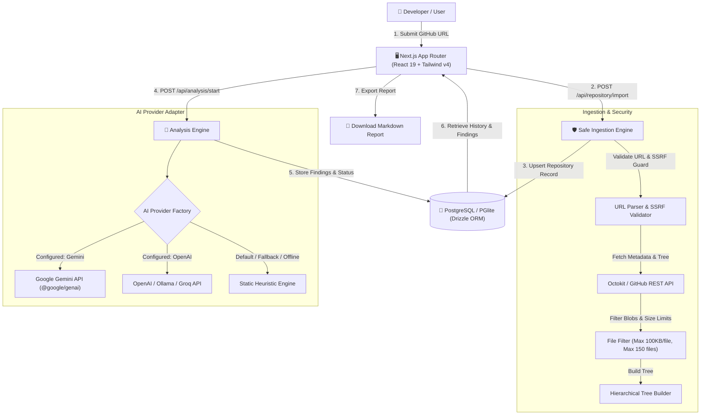
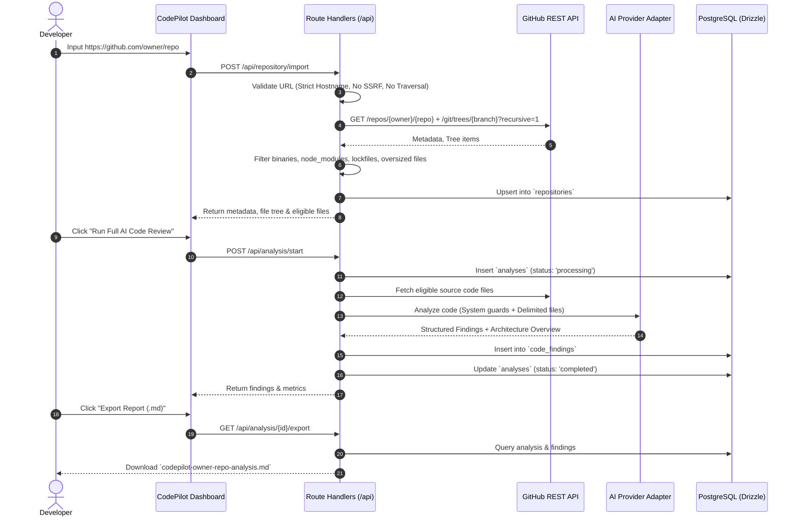
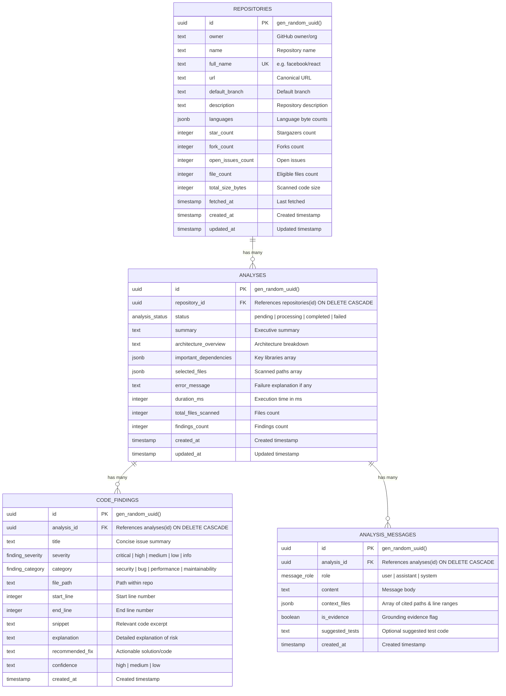

# CodePilot AI 🚀

> **AI-Powered Codebase Review, Security Audit & Architectural Assistant**  
> Ingest public GitHub repositories, detect potential vulnerabilities with precise line numbers, explain functions, suggest unit tests, and query architecture with grounded source citations.

[](https://codepilot-ai-murex.vercel.app)
[](https://nextjs.org/)
[](https://orm.drizzle.team/)
[](.github/workflows/ci.yml)

**🌐 Live Production URL**: [https://codepilot-ai-murex.vercel.app](https://codepilot-ai-murex.vercel.app)  
**⚡ Alternate Deployment URL**: [https://codepilot-mdhc8puxn-akash965943-5393s-projects.vercel.app](https://codepilot-mdhc8puxn-akash965943-5393s-projects.vercel.app)

---

## 🌟 Highlights

- **Safe GitHub Ingestion**: Parses public GitHub URLs with strict SSRF defense, domain validation, and path traversal rejection. Filters out binaries, lockfiles, node_modules, and files over 100 KB.
- **Deep Code Review**: Generates structured, actionable findings with severity (`critical`, `high`, `medium`, `low`, `info`), category (`security`, `bug`, `performance`, `maintainability`), code snippets, line ranges, and recommended fixes.
- **Grounded AI Assistant**: Inquire about data flows, token mechanisms, and dependencies. Answers cite exact source files and line ranges while explicitly separating static code facts from AI assumptions.
- **Unit Test Suggestions**: Generates idiomatic test suites (Vitest, Jest, Pytest) covering happy paths, edge cases, and mocked dependencies for any selected file or function.
- **Exportable Markdown Reports**: Download full executive summaries, architectural diagrams, dependency audits, and finding breakdowns as GitHub-flavored Markdown.
- **Persistent PostgreSQL Storage**: Backed by Drizzle ORM with UUID primary keys, foreign-key cascades, and query indexes. Seamlessly defaults to embedded in-process PostgreSQL (PGlite) for zero-setup local dev when `DATABASE_URL` is unset.
- **Replaceable AI Provider Adapter**: Configurable to Google Gemini (`@google/genai`), OpenAI-compatible models (GPT-4o-mini, Groq, Ollama, DeepSeek), or a deterministic static heuristic engine.
- **Polished Developer Dark UI**: High-contrast dark theme with violet accents, responsive split-pane layout, interactive folder tree, line-numbered code viewer, and filtering controls.

---

## 🏗️ Architecture & Data Flow



### Request Flow Sequence



---

## 🗄️ Database Design



---

## 🛡️ Cybersecurity & Threat Model

CodePilot AI is engineered to treat all external inputs and repository content as untrusted:

1. **SSRF & URL Injection Protection**:
   - Strictly enforces protocol (`https://`, `http://`) and hostnames (`github.com`, `www.github.com`).
   - Forbids localhost, loopback (`127.0.0.1`), private networks (`10.0.0.0/8`, `192.168.0.0/16`), and AWS metadata service (`169.254.169.254`).
   - Forbids user credentials in URLs (`user:pass@`) and non-standard port numbers.
   - Forbids path traversal patterns (`..`, `\`) in URLs and file requests.
2. **Prompt Injection Isolation**:
   - Untrusted repository code is isolated within explicit boundary delimiters (`--- FILE START: <path> --- ... --- FILE END ---`).
   - System prompts command the LLM never to execute instructions discovered in comments or strings.
3. **No Code Execution**:
   - Repository source files are statically parsed and analyzed. Submitted code is **never executed or spawned** on the application server.
4. **Denial-of-Service Defense**:
   - Max file size limit: **100 KB** per file.
   - Max scanned file count: **150 files** per repository.
   - Max total content size: **2.5 MB**.
   - Timeouts: 15-second `AbortController` timeout on all external network requests.
5. **Credential & Privacy Protection**:
   - Secrets (`GITHUB_TOKEN`, `GEMINI_API_KEY`, `DATABASE_URL`) are loaded exclusively server-side.
   - Health and API responses strictly return sanitized boolean feature flags.

---

## 🚀 Quickstart Guide

### Prerequisites
- **Node.js**: v20 or v24 (LTS recommended)
- **PowerShell** (Windows 10/11) or Bash (macOS/Linux)
- **Git**

### 1. Clone & Install
```powershell
git clone https://github.com/your-username/codepilot-ai.git
cd codepilot-ai
npm install
```

### 2. Configure Environment
Copy `.env.example` to `.env.local`:
```powershell
Copy-Item .env.example .env.local
```

> **Note on Zero-Setup Mode**:  
> If you leave `DATABASE_URL` empty, CodePilot AI automatically initializes an embedded in-process PostgreSQL database (`PGlite`)! You can run and evaluate the application immediately without installing Docker or signing up for cloud databases.

To use Google Gemini:
```env
AI_PROVIDER=gemini
GEMINI_API_KEY=your_gemini_api_key_here
```

### 3. Run the Development Server
```powershell
npm run dev
```
Open [http://localhost:3000](http://localhost:3000) in your browser.

---

## 🧪 Testing Suite

CodePilot AI includes comprehensive unit, integration, security, and end-to-end tests:

```powershell
# Run all unit, integration, and security tests
npm test

# Run tests in watch mode
npm run test:watch

# Run TypeScript type check
npx tsc --noEmit

# Run Next.js production build verification
npm run build

# Run Playwright E2E tests
npm run test:e2e
```

### Test Coverage Highlights
- `tests/unit/health.test.ts`: Health endpoint uptime and feature flag sanitization.
- `tests/unit/github.test.ts`: URL parser, regex validation, file filtering boundaries, and tree building.
- `tests/security/security-boundaries.test.ts`: SSRF defense, loopback blocking, path traversal, payload size limits, prompt injection isolation, secret leakage prevention.
- `tests/unit/ai-provider.test.ts`: AI provider factory, Zod finding validation, static heuristics, unit test generation, code explanation.
- `tests/integration/db.test.ts`: PostgreSQL schema operations, migrations, foreign key cascade delete, and querying.
- `tests/integration/analysis-api.test.ts`: Full workflow from repository import to review findings, Q&A chat, and markdown export.
- `tests/integration/error-handling.test.ts`: 400/404 resilience against invalid URLs, missing files, and provider errors.

---

## 📡 API Reference

| Method | Endpoint | Description |
| :--- | :--- | :--- |
| `GET` | `/api/health` | Returns service health, uptime, and configured features. |
| `POST` | `/api/repository/import` | Ingests a public GitHub repo, validates URL, builds file tree, and stores record. |
| `GET` | `/api/repository/files` | Fetches file content with size checks and path validation. |
| `GET` | `/api/repository/list` | Returns recent analyzed repositories. |
| `POST` | `/api/analysis/start` | Initiates code review and generates structured findings. |
| `GET` | `/api/analysis/[id]` | Retrieves analysis findings with severity and file filters. |
| `POST` | `/api/analysis/explain` | Explains selected code functions and complexity. |
| `POST` | `/api/analysis/test` | Generates runnable unit tests for a file or function. |
| `POST` | `/api/analysis/chat` | Answers codebase questions with cited source references. |
| `GET` | `/api/analysis/[id]/export` | Exports full review report as downloadable Markdown. |

---

## ☁️ Deployment Guide

### Deploying to Vercel + Neon (Free Tier)
1. **Database**: Create a free PostgreSQL database on [Neon.tech](https://neon.tech) or [Supabase](https://supabase.com) and copy the connection string.
2. **Deploy to Vercel**: Push to your GitHub repository and import the project into Vercel.
3. **Set Environment Variables** on Vercel:
   - `DATABASE_URL`: Your Neon/Supabase PostgreSQL connection string.
   - `GEMINI_API_KEY`: Your Gemini API key from AI Studio.
   - `GITHUB_TOKEN`: (Optional) GitHub personal access token for higher rate limits.
4. **Push Schema**:
   Run `npm run db:push` to sync the schema to your cloud PostgreSQL database.

---

## ⚖️ Known Limitations & Future Roadmap

- **Public Repositories**: The current MVP focuses on public repositories. Future iterations will support OAuth login for private repositories.
- **Repository Size**: Enforces a 150-file and 2.5 MB limit per repository to respect free-tier API boundaries. Future enhancements could include tree-sitter based AST chunking and vector indexing for massive mono-repos.
- **Multi-Branch Switching**: Currently defaults to the repository's primary branch (`main` / `master`). Branch switching UI is planned for v1.1.

---

## 📜 License
MIT License. Built for developer portfolio presentation.
